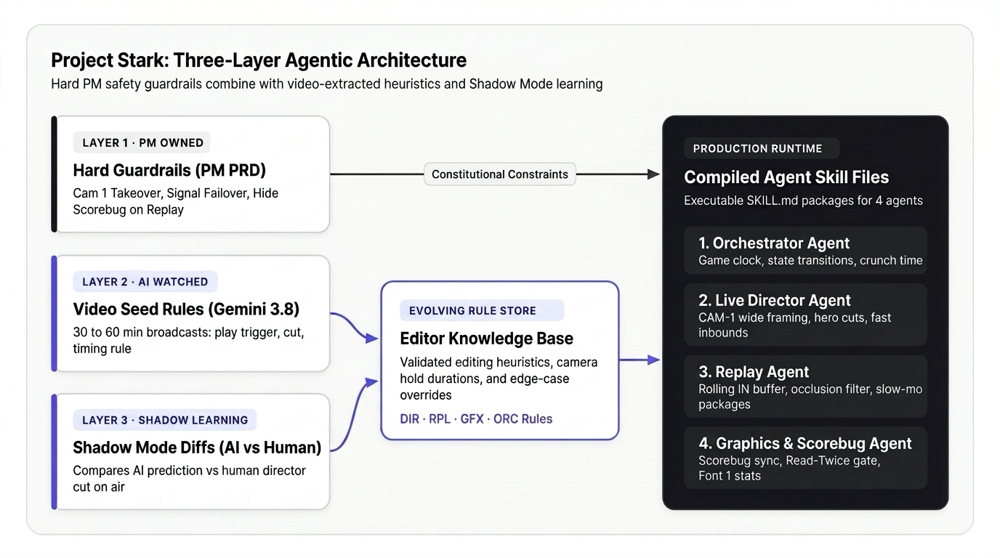

# Project Stark: Agentic Strategy

**Reference:** go/project-stark-prd  
**Author:** Sandhya Patil  
**Audience:** Product Management & Engineering Leadership

## Why Manual Rules Hit a Wall

Writing if-else rules and interview notes for live sports editing feels endless because live basketball is not a fixed state machine. Every cut in a 30 to 60 minute broadcast depends on several variables changing at the same time:

**Broadcast State = (Game Clock, Shot Clock, Score Margin, Fouls, Scoring Run, Camera Occlusion, Inbound Speed, Crowd Energy)**

Trying to document every combination in a spreadsheet or PRD breaks down for two reasons:

1. **Combinatorial Explosion:** A rule like *"After a made 3-pointer, cut to the shooter's Iso camera for 3 seconds"* works in the first quarter. It fails when there are 45 seconds left in a 2-point game and the opposing team is running a fast-break inbound against a full-court press.
2. **Tacit Muscle Memory vs. Interview Notes:** Veteran broadcast directors and technical directors make sub-second cuts from instinct built over thousands of games. In interviews, they describe their general habits, not the dozens of micro-exceptions they make on air. Their true logic lives on the broadcast tape, not in interview notes.

## The Coding Agent Analogy

When Google DeepMind built coding and game-playing agents, Product Managers did not hand-write an if-else rule for every compiler error or board position. Instead, agents learned effective behaviors by observing real trajectories and outcomes.

Applying that same principle to Project Stark is the right strategic move, with **one critical safeguard for live television**:

* **Where the Analogy Holds (Pacing & Framing):** Camera pacing, when to punch into a hero shot, which replay angle looks cleanest, and when a dead-ball pause is long enough for a stat graphic should be **learned directly from watching real broadcasts**, not hand-coded in a PRD.
* **Where Live TV Differs (Zero Retry Buffer):** A coding agent runs in a sandbox. If it makes a bad edit, a test fails and the agent retries before a user ever sees it. Live sports broadcasts have zero retry buffer on air. If an agent cuts away from a live game-winner or airs a slow-motion replay of a severe player injury, we cannot undo it.

Because of this, we should not replace the PRD with an unconstrained black box. Instead, we should separate **hard broadcast guardrails** from **learned editing skills**.

## Recommended Three-Layer Architecture

We recommend restructuring Project Stark into three layers so Product defines safety boundaries while Gemini Video Intelligence learns editing craft from real games:

### Layer 1: Hard Broadcast Guardrails (PM Owned)
The PRD (go/project-stark-prd) stops trying to script every camera cut. Instead, it defines a small set of **non-negotiable safety rules** that the agents can never violate:

* **Cam 1 Safety Takeover (CUJ 1.4):** Immediately lock onto CAM-1 (Main Wide) and suppress all replays if an injury, altercation, or tracking failure occurs.
* **Signal Glitch Failover (CUJ 1.1):** Ignore single-frame flickers; automatically switch to CAM-2 if the primary feed suffers a sustained signal drop.
* **Hide Scorebug on Replays (CUJ 9.3):** Always hide the live Scorebug during replay packages so viewers never confuse a replay with live action.
* **Read-Twice Graphic Rule (CUJ 10.3):** Preview stats on Font 1 and only air lower-thirds when the dead-ball pause is long enough to read the text twice.

### Layer 2: Video-Extracted Seed Skills (AI Watched)
Instead of writing manual rules from interviews, we feed 30 to 60 minute broadcast recordings into Gemini 3.8 Video Intelligence. The model extracts **two complementary tiers of rules**:
1. **Macro Game-Storytelling & Pacing Patterns (STORY-01 to STORY-06):** Overall game-level rules governing camera air-time allocation (for example, keeping **CAM-1 Wide** on air for ~68% to 74% of the full game vs. ~12% to 15% on **CAM-3 Hero Iso**), the **Three-Act Tempo Arc** across halves (opening establishment -> mid-game scoring runs -> crunch-time lockout), **star player hot-hand and foul-trouble continuity** across possessions, and 10-minute replay/graphic spacing budgets.
2. **Shot-Level Transition Heuristics (DIR-*, RPL-*, GFX-*, ORC-*):** Moment-by-moment cuts, replay triggers, and graphic gates based on what happened on court, what the human editor did, and why it worked.

These patterns are automatically compiled into modular skill files for four specialized agents:
* **Orchestrator Agent:** Monitors game state, clock situations, three-act game tempo, and cues the specialist agents.
* **Live Director Agent:** Balances full-game camera share (**STORY-01**) and switches between CAM-1 through CAM-5 during live play and reactions.
* **Replay Agent:** Marks IN points on whistles/scores, manages the 10-minute replay cadence (**STORY-05**), and builds slow-motion replay packages.
* **Graphics & Scorebug Agent:** Manages the scorebug, bonus indicators, lower-third spacing (**STORY-06**), and storyline stat progression.

### Layer 3: Shadow Mode Continuous Learning
Once the initial skills are built, the agents run in **Shadow Mode** during live broadcasts alongside a human director:

1. The agents watch the live feeds and predict which camera to cut to or which replay to queue.
2. The system compares the agent's prediction against what the human director actually put on air.
3. Whenever they disagree, Gemini inspects that 10-second video clip, figures out *why* the human director made a different call, and drafts a new rule for the agent skill file.

## Examples: Static PRD vs. Video Learning

Here are examples at both the **Macro Game-Storytelling** level and the **Shot-Level Transition** level where a static PRD rule fails, but video learning captures the true broadcast pattern:

| Scenario | What a Static PRD Rule Does | What the Human Director Actually Did | New Rule Learned |
| :--- | :--- | :--- | :--- |
| **Full-Game Camera Balance & Story Arc (Macro)** | Treats every possession identically with no awareness of overall camera share or game phase. | Kept **CAM-1 Wide** on air ~68% to 74% of the game, held wider longer in the opening 5 minutes, and tracked hot-hand / foul-trouble arcs every ~4 to 6 minutes on dead balls. | **Macro Camera Allocation & Three-Act Pacing (STORY-01 / STORY-02):** Maintain ~68% to 74% CAM-1 baseline share (~12% to 15% CAM-3 Hero Iso) and shift tempo across Opening Establishment, Mid-Game Runs, and Crunch Time. |
| **Fast Inbound After Made 3 (Shot-Level)** | Holds CAM-3 (Shooter Iso) for a fixed 3.0s after the basket. | Cut back to CAM-1 (Wide) after a sub-second reaction flash (example: 0.7s to 0.9s) because the defense pushed a fast break. | **Fast-Inbound Override (DIR-04):** Sub-second hero cut is allowed on fast inbounds (example: 0.7s to 0.9s); return to CAM-1 before mid-court. |
| **Quick Side-Out Whistle (Shot-Level)** | Airs a queued player stat graphic on the next whistle. | Held the graphic in queue because a quick side-out throw-in is too brief to read. | **Pause Length Gate (GFX-03):** Air full lower-thirds only on extended stoppages such as shooting fouls, free throws, or timeouts (example: 6s or longer), never on quick side-outs. |
| **Blocked Replay Angle (Shot-Level)** | Automatically rolls CAM-2 (Baseline) + CAM-3 on a dunk replay. | Dropped CAM-2 because a referee stepped in front of the lens at the rim. | **Occlusion Filter (RPL-03):** Drop any replay angle where the ball or rim is occluded and substitute CAM-5 (Above-Rim). |

## What Changes for Product & Engineering

1. **Stop Expanding Manual If-Else Trees:** Freeze the PRD on the Two-Role Operating Model (Human Showmaker + AI Broadcast Agent) and the Layer 1 Safety Guardrails.
2. **Scale by Watching Games, Not Writing Docs:** Use the CourtVision ingestion pipeline to process 30 to 60 minute game recordings and grow the Editor Knowledge Base automatically.
3. **Review Learned Rules Like Code PRs:** Instead of writing rules from scratch, PMs and veteran directors simply approve or reject the new rules discovered during Shadow Mode.

## YouTube Playlist Corpus Scope (Active vs. Excluded Clips)

From the 570 public videos in the **NCAA College Basketball** YouTube playlist (https://www.youtube.com/playlist), the active Editor Knowledge Base is currently scoped to full and condensed game broadcasts so pacing rules reflect continuous game flow:

* **Active Broadcast Corpus (52 Videos Included):** Full and condensed game broadcasts (25 to 72 minutes each, 7,984 extracted game moments across 54 total broadcasts including the 2 preloaded reference games).
* **Excluded for Now (Reserved for Later Ingestion):**
  * **409 Game Highlight Broadcasts** (8 to 20 minutes each)
  * **109 Postgame & Feature Clips** (trophy ceremonies, interviews, and studio breakdowns)
  * *Note:* All 518 excluded videos remain cataloged in **backend/app/broadcast_playlist_catalog.json** (flagged with **included_in_active_corpus: false**) so they can be brought back in later if needed.

